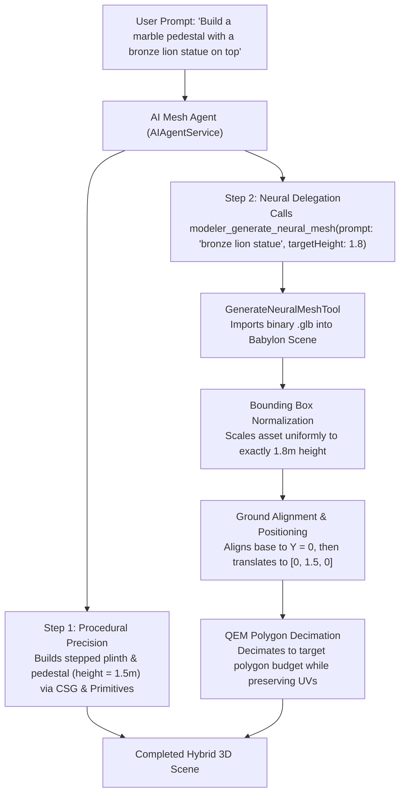

# 3D Mesh Editor

[](LICENSE)
[](https://www.typescriptlang.org/)
[](https://www.babylonjs.com/)
[](tests/integration/)
[](https://www.electronjs.org/)

A professional, modular 3D model studio and mesh manipulation workbench built with **TypeScript** and **Babylon.js 9.x**. Engineered from the ground up to function across multiple deployment targets through a decoupled **Platform Adapter Architecture**:

1. **Standalone Web Application** (Full-featured browser 3D studio with local dev server)
2. **NPM Library & Web Component** (`<mesh-editor>` Custom Element + modular ESM / UMD TypeScript classes)
3. **Desktop Application** (Cross-platform native macOS `.dmg`, Windows `.exe`, and Linux `.AppImage`/`.deb` via Electron)

Distributed under the **[Apache License 2.0](LICENSE)**.

---

## Table of Contents

- [Architectural Overview](#architectural-overview)
  - [Directory Structure](#directory-structure)
  - [Core Design Principles](#core-design-principles)
- [Viewport Navigation & Keyboard Shortcuts](#viewport-navigation--keyboard-shortcuts)
- [Decentralized Modular Tool Architecture](#decentralized-modular-tool-architecture)
  - [Built-In Editor Tools](#built-in-editor-tools)
  - [Authoring Guide: Adding a New Editor Tool](#authoring-guide-adding-a-new-editor-tool)
- [Procedural & AI-Callable Tool Pipeline](#procedural--ai-callable-tool-pipeline)
  - [Built-In AI Modeling Tools](#built-in-ai-modeling-tools)
  - [ToolRegistry & OpenAI Function Schemas](#toolregistry--openai-function-schemas)
- [Bring-Your-Own-AI (BYO-AI) & Modeling Skills](#bring-your-own-ai-byo-ai--modeling-skills)
  - [Supported LLM / VLM Endpoints](#supported-llm--vlm-endpoints)
  - [Antigravity Local CLI Bridge (`agy`)](#antigravity-local-cli-bridge-agy)
  - [Domain-Specific Modeling Skills](#domain-specific-modeling-skills)
- [Hybrid Neural 3D Generators (TRELLIS 2, Hunyuan3D, Hi3D)](#hybrid-neural-3d-generators-trellis-2-hunyuan3d-hi3d)
  - [Multi-Provider Protocols](#multi-provider-protocols)
  - [Procedural + Neural Composition Workflow](#procedural--neural-composition-workflow)
- [Web Component & NPM Library Integration](#web-component--npm-library-integration)
  - [Using `<mesh-editor>` Custom Element](#using-mesh-editor-custom-element)
  - [Programmatic TypeScript Integration](#programmatic-typescript-integration)
- [Extensibility & Custom Plugin System](#extensibility--custom-plugin-system)
- [Desktop Application (Electron)](#desktop-application-electron)
- [Testing Architecture & Test Suites](#testing-architecture--test-suites)
  - [Headless 3D Integration Tests (Vitest + NullEngine)](#headless-3d-integration-tests-vitest--nullengine)
  - [Browser E2E Tests (Playwright)](#browser-e2e-tests-playwright)
- [Developer Scripts & Build Workflow](#developer-scripts--build-workflow)
- [CI/CD & GitHub Actions Workflows](#cicd--github-actions-workflows)
- [License](#license)

---

## Architectural Overview

The Mesh Editor is structured into decoupled layers to ensure complete isolation from project-specific assets, APIs, and host environments:

```
mesheditor/
├── src/
│   ├── index.ts                          # Public API exports, <mesh-editor> registration, auto-bootstrapper
│   ├── types.ts                          # Shared data types, AI & Neural 3D provider configs, events
│   ├── plugin.ts                         # Plugin interfaces (MeshEditorPlugin, Context, PluginManager)
│   ├── template.ts                       # Compiled HTML UI template (synced from mesheditor.ejs & tool views)
│   ├── styles.ts                         # Auto-injected CSS stylesheet for Web Component / NPM bundles
│   ├── builtInSkills.ts                  # Compiled AI modeling skills (synced from skills/*.md)
│   ├── AIAgentService.ts                 # Multi-turn BYO-AI agent orchestrator, SSE streaming, multi-provider client
│   ├── Neural3DGeneratorService.ts       # Multi-provider Neural 3D client (TRELLIS 2, Hunyuan3D, Hi3D)
│   ├── MeshEditorService.ts              # Core 3D engine: meshes, gizmos, CSG2, facets, transforms, export
│   ├── MeshEditorApp.ts                  # UI coordinator: outliner tree sync, layout modes, window manager
│   ├── tools/                            # Modular tool system
│   │   ├── ToolInterface.ts              # Tool contracts, metadata, lifecycle hooks, AI function schemas
│   │   ├── AbstractTool.ts               # Base tool with scene, math, and mesh helper utilities
│   │   ├── ToolRegistry.ts               # Runtime registry & execution dispatcher (44 built-in + 20 editor tools)
│   │   ├── ToolExecutionContext.ts       # Execution context passed to tools during execution
│   │   ├── editor/                       # Decentralized editor tools & EJS view templates
│   │   │   ├── AbstractEditorTool.ts     # Base editor tool with dynamic DOM mounting & EJS compilation
│   │   │   ├── toolViews.ts              # Auto-compiled EJS view templates
│   │   │   ├── OutlinerEditorTool.ts / .ejs
│   │   │   ├── CreatePrimitiveEditorTool.ts / .ejs
│   │   │   ├── CSGEditorTool.ts / .ejs
│   │   │   ├── FacetEditorTool.ts / .ejs
│   │   │   ├── SculptEditorTool.ts / .ejs
│   │   │   ├── VoxelPainterEditorTool.ts / .ejs
│   │   │   ├── PathExtrusionEditorTool.ts / .ejs
│   │   │   ├── AIAgentEditorTool.ts / .ejs
│   │   │   ├── MeshPropertiesEditorTool.ts / .ejs
│   │   │   ├── MaterialEditorTool.ts / .ejs
│   │   │   ├── UVUnwrapEditorTool.ts / .ejs
│   │   │   ├── BakingEditorTool.ts / .ejs
│   │   │   ├── TextureOptimizerEditorTool.ts / .ejs
│   │   │   ├── CompressModelEditorTool.ts / .ejs
│   │   │   ├── SceneEnvironmentEditorTool.ts / .ejs
│   │   │   ├── AnimationPlayerEditorTool.ts / .ejs
│   │   │   ├── RiggingEditorTool.ts / .ejs
│   │   │   ├── AITextureEditorTool.ts / .ejs
│   │   │   ├── TextMeshEditorTool.ts / .ejs
│   │   │   └── DecalEditorTool.ts / .ejs
│   │   └── builtin/                      # 44 AI-callable procedural & manipulation tools
│   ├── voxel/                            # Voxel painter engine (custom mesher, palette, texture atlas)
│   ├── pathExtrusion/                    # Spline path factory, extrusion controller, 2D profiles
│   ├── sculpting/                        # Dynamic topology sculpt controller & brush falloffs
│   ├── uv/                               # UV unwrapping (LSCM, ABF conformal, seam management)
│   ├── baking/                           # Texture baking (normal maps, ambient occlusion, diffuse)
│   ├── rigging/                          # Skeletal bone authoring & vertex weight painting
│   ├── textures/                         # AI texture generator, external image service, WebP optimizer
│   ├── textMesh/                         # 3D vector text generation using typeface JSON fonts
│   ├── decals/                           # Decal projection onto arbitrary 3D mesh surfaces
│   ├── compression/                      # QEM polygon decimation & WebP texture compression
│   ├── sdf/                              # Signed Distance Fields & Surface Nets polygonizer
│   ├── geometry/                         # Bevel modifier, architecture helpers, rounded boxes, facet math
│   ├── adapters/                         # Multi-platform runtime bridges
│   │   ├── PlatformAdapter.ts            # Adapter contract (native file open/save dialogs, menu bridge)
│   │   ├── BrowserPlatformAdapter.ts     # Standalone browser file input & download adapter
│   │   ├── ElectronPlatformAdapter.ts    # Native desktop adapter (macOS, Windows, Linux native dialogs)
│   │   └── HostAppAdapter.ts             # Embedded host application adapter (custom save callbacks)
│   ├── web-component/                    # <mesh-editor> Custom Element implementation
│   ├── mesheditor.ejs                    # Entry HTML template with decentralized tool includes
│   └── mesheditor.css                    # Dark theme styles, floating & stackpanel layouts, tool widgets
├── skills/                               # Domain-specific AI modeling skills (Markdown)
│   ├── figure-sculptor.md                # Organic anatomy blockouts, dynamic sculpting, game retopology
│   ├── procedural-modeler.md             # CSG2 booleans, lathe, spline extrusion, architectural construction
│   ├── mesh-updater.md                   # Scene inspection, targeted geometry updates, hierarchy maintenance
│   ├── neural-3d-generator.md            # TRELLIS 2, Hunyuan3D, Hi3D delegation, normalization & grounding
│   ├── voxel-painter.md                  # Voxel grids, multi-layer palettes, custom meshing
│   └── image-to-mesh.md                  # Vision-guided 2D reference reconstruction
├── electron/
│   ├── main.js                           # Electron main process (native menus, file I/O, IPC bridge)
│   └── preload.js                        # Context-isolated secure preload bridge (`window.meshEditorElectron`)
├── scripts/
│   ├── antigravity-bridge.js             # Local OpenAI-compatible proxy bridge to Antigravity CLI (`agy`)
│   ├── sync-templates.js                 # Compiles decentralized `.ejs` views into `toolViews.ts` & `template.ts`
│   ├── sync-skills.js                    # Injects markdown skills into `src/builtInSkills.ts`
│   ├── sync-styles.js                    # Injects `src/mesheditor.css` into `src/styles.ts`
│   ├── generate-icons.js                 # Generates desktop `.icns`, `.ico`, and `.png` icons
│   └── prepare-pages.js                  # Prepares distribution bundle for GitHub Pages
└── tests/
    ├── integration/                      # 15 Vitest headless 3D test suites with Babylon NullEngine (211 tests)
    └── e2e/                              # Playwright Chromium real-browser WebGL workflow tests
```

### Core Design Principles

1. **Engine Decoupling (`MeshEditorService`)**: Encapsulates Babylon.js engine setup, `UniversalCamera`, lighting, gizmo managers, CSG2 boolean operations, vertex/facet editing, and import/export formats (`.glb`, `.gltf`, `.obj`, `.stl`). It operates on pure DOM canvas elements, files, and binary Blobs without hardcoded asset URLs.
2. **Headless Engine Ingestion (`customEngine`)**: Both `MeshEditorService` and `MeshEditorApp` support constructor injection of Babylon's headless **`NullEngine`**, enabling full 3D integration testing directly inside Node.js without requiring a physical GPU or display.
3. **UI Coordination (`MeshEditorApp`)**: Manages floating vs. stackpanel layouts, window dragging and docking, the hierarchical Outliner tree, dropdown menus, and modal dialogs.
4. **Decentralized Tool Isolation**: Every editor tool lives in its own self-contained module containing its TypeScript class, dedicated EJS view, in-app documentation, and lifecycle hooks.
5. **Zero Host Couplings in Core**: Project-specific features (such as custom asset browsers, database sync, or proprietary authentication) are implemented as clean external plugins via the `MeshEditorPlugin` API.

---

## Viewport Navigation & Keyboard Shortcuts

### Mouse Controls

| Action | Control | Description |
| :--- | :--- | :--- |
| **Orbit Camera** | `Right Click + Drag` | Free look and orbital rotation around the scene or target |
| **Pan Camera** | `Middle Click + Drag` | Pan camera view horizontally and vertically |
| **Select / Manipulate** | `Left Click` | Select mesh, pick vertices/facets, or drag gizmo handles |
| **Zoom View** | `Mouse Wheel` | Smooth forward and backward camera zoom |

### Keyboard Navigation

| Key | Action |
| :--- | :--- |
| **W / Up Arrow** | Move camera forward |
| **S / Down Arrow** | Move camera backward |
| **A / Left Arrow** | Move camera left (strafe) |
| **D / Right Arrow** | Move camera right (strafe) |

### Transformation Gizmos & Editing Shortcuts

| Key Shortcut | Tool / Action | Description |
| :--- | :--- | :--- |
| **M** | Move Gizmo | Activates 3D translation gizmo |
| **E** | Rotate Gizmo | Activates 3D rotation gizmo |
| **R** | Scale Gizmo | Activates 3D uniform & axis scale gizmo |
| **B** | Bounds Gizmo | Activates bounding-box sizing handles |
| **F** | Focus View | Centers and focuses camera on selected mesh |
| **Del / Backspace** | Delete | Removes selected mesh, group, or hierarchy node |
| **⌘Z / Ctrl+Z** | Undo | Reverts last transformation, creation, or CSG operation |
| **⇧⌘Z / Ctrl+Y** | Redo | Re-applies undone operation |
| **⌘G / Ctrl+G** | Group | Groups selected meshes under a new parent transform |
| **⇧⌘G / Ctrl+Shift+G** | Ungroup | Dissolves group and restores world transforms |
| **⌘C / Ctrl+C** | Copy | Copies selected mesh to clipboard |
| **⌘V / Ctrl+V** | Paste | Pastes copied mesh at cursor or scene origin |
| **⌘D / Ctrl+D** | Duplicate | Duplicates selected mesh in place |
| **Esc** | Cancel / Close | Cancels active Pick & Place mode or closes open popups |

---

## Decentralized Modular Tool Architecture

The Mesh Editor employs a **Decentralized Modular Tool Architecture**. Rather than hardcoding tool logic and dialog markup into monolithic files, every tool is an independent, self-contained unit encapsulating its logic, HTML view, in-app help guide, and lifecycle management.

### Built-In Editor Tools

The editor ships with **20 decentralized editor tools** located in [`src/tools/editor/`](src/tools/editor/):

| Tool Class | View Template | Category | Description |
| :--- | :--- | :--- | :--- |
| **`OutlinerEditorTool`** | `OutlinerEditorTool.ejs` | Scene Graph | Hierarchical scene tree with nesting, search filter, visibility toggle, and deletion |
| **`CreatePrimitiveEditorTool`** | `CreatePrimitiveEditorTool.ejs` | Modeling | Parametric primitives (Box, Sphere, Cylinder, Capsule, Torus, Plane, Ground, Polyhedron) |
| **`CSGEditorTool`** | `CSGEditorTool.ejs` | Modeling | Real-time boolean operations (Union, Subtract, Intersect) powered by Babylon CSG2 |
| **`FacetEditorTool`** | `FacetEditorTool.ejs` | Modeling | Sub-mesh editing: triangular facet selection, extrude, inset, arc, cut-through, normal flipping |
| **`SculptEditorTool`** | `SculptEditorTool.ejs` | Sculpting | Dynamic topology sculpting brushes (Grab, Clay, Smooth, Inflate, Flatten, Crease) |
| **`VoxelPainterEditorTool`** | `VoxelPainterEditorTool.ejs` | Voxel | 3D voxel placement/erasing, color palettes, custom meshing, and texture atlas generation |
| **`PathExtrusionEditorTool`** | `PathExtrusionEditorTool.ejs` | Modeling | Extrudes 2D profiles (circle, star, rectangle, n-gon) along 3D Catmull-Rom & linear splines |
| **`AIAgentEditorTool`** | `AIAgentEditorTool.ejs` | AI Co-Pilot | Multi-turn AI assistant with SSE streaming, tool-calling execution, and prompt examples |
| **`MeshPropertiesEditorTool`** | `MeshPropertiesEditorTool.ejs` | Geometry | Precise transform inputs, origin recentering, snap-to-ground ($Y \ge 0$), and transform baking |
| **`MaterialEditorTool`** | `MaterialEditorTool.ejs` | Shading | PBR material authoring (albedo, roughness, metallic, emissive, UV scale/offset, planar mapping) |
| **`UVUnwrapEditorTool`** | `UVUnwrapEditorTool.ejs` | UV Pipeline | Conformal UV unwrapping (LSCM / ABF), seam marking, and UV island layout |
| **`BakingEditorTool`** | `BakingEditorTool.ejs` | Baking | Texture baker for high-to-low poly normal maps, ambient occlusion, and diffuse baking |
| **`TextureOptimizerEditorTool`** | `TextureOptimizerEditorTool.ejs` | Optimization | Interactive WebP texture conversion, downsampling, and VRAM footprint inspector |
| **`CompressModelEditorTool`** | `CompressModelEditorTool.ejs` | Optimization | Geometry decimation (QEM), WebP compression, and optimized GLB export |
| **`SceneEnvironmentEditorTool`** | `SceneEnvironmentEditorTool.ejs` | Environment | Skybox, HDR environment lighting, ground grid customization, directional lights, and FOV |
| **`AnimationPlayerEditorTool`** | `AnimationPlayerEditorTool.ejs` | Animation | Timeline scrubber, playback controls, animation group selector, and bone inspection |
| **`RiggingEditorTool`** | `RiggingEditorTool.ejs` | Rigging | Skeletal bone generation, joint hierarchy, and interactive vertex weight painting |
| **`AITextureEditorTool`** | `AITextureEditorTool.ejs` | AI Generation | AI-assisted procedural and neural texture generation with seamless tiling synthesis |
| **`TextMeshEditorTool`** | `TextMeshEditorTool.ejs` | Modeling | 3D extruded vector text generation using typeface JSON fonts |
| **`DecalEditorTool`** | `DecalEditorTool.ejs` | Materials | Decal stamp projection onto arbitrary 3D mesh surfaces with orientation and size controls |

### Architectural Guidelines for Editor Tools

- **Top Toolbar Policy**: The top toolbar (`#top-toolbar`) is reserved for branding, dropdown menus, undo/redo, transformation gizmos, and the help modal shortcut. Never add quick-toggle buttons to `#top-toolbar`. All editor tools are accessed exclusively through the dynamically built **Tools** dropdown menu (`#menuTools`).
- **Dynamic Menu Generation**: `#menuTools` is built 100% dynamically at runtime via `MeshEditorApp.renderToolsMenu()`. Registering a tool class in `createBuiltinEditorTools()` automatically creates its menu entry, Lucide icon, label, ordering, and click toggling.
- **Exclusive Viewport Clicks**: Tools that capture 3D viewport clicks (e.g. Voxel Painter, Sculpting, Spline editing) set `isExclusive3DTool: true`. Activating one exclusive tool automatically deactivates 3D editing on other exclusive tools without closing their dialogs.
- **Unified Dark Theme CSS**: All floating dialogs use unified classes: `.tool-control-group`, `.tool-row`, `.tool-label`, `.tool-select`, `.tool-input`, `.tool-action-btn`, and `.tool-btn-primary`.

---

### Authoring Guide: Adding a New Editor Tool

Follow this step-by-step checklist to build and register a new tool:

#### Step 1: Create the EJS View Template

Create `src/tools/editor/MyCustomEditorTool.ejs`:

```html
<div id="dialog-my-custom-tool" class="floating-dialog" style="top: 100px; left: 348px; width: 340px; display: none">
  <div class="dialog-header">
    <span class="dialog-title"><i class="app-icon" data-lucide="wand-2"></i> Custom Generator</span>
    <div class="dialog-actions">
      <button class="dialog-btn btn-help" title="Help & Tool Guide" aria-label="Help"><i class="app-icon" data-lucide="help-circle"></i></button>
      <button class="dialog-btn btn-min" title="Minimize"><i class="app-icon" data-lucide="minus"></i></button>
      <button class="dialog-btn btn-close" title="Close"><i class="app-icon" data-lucide="x"></i></button>
    </div>
  </div>
  <div class="dialog-body my-custom-tool-body">
    <div class="tool-control-group">
      <div class="tool-row">
        <label class="tool-label" for="customSize">Mesh Radius:</label>
        <input type="number" id="customSize" class="tool-input tool-number" value="1.0" min="0.1" max="20.0" step="0.5" />
      </div>
    </div>
    <button class="tool-action-btn tool-btn-primary" id="btnExecuteCustomTool" style="width: 100%">
      <i class="app-icon" data-lucide="play"></i> Generate Mesh
    </button>
  </div>
</div>
```

#### Step 2: Implement the Tool Class

Create `src/tools/editor/MyCustomEditorTool.ts` extending `AbstractEditorTool`:

```typescript
import { AbstractEditorTool } from './AbstractEditorTool';
import { ToolExecutionContext } from '../ToolExecutionContext';

export class MyCustomEditorTool extends AbstractEditorTool {
  public readonly name = 'my_custom_tool';
  public readonly dialogId = 'dialog-my-custom-tool';
  public readonly triggerButtonId = 'btnToggleMyCustomTool';
  public readonly menuId = 'menuTools';
  public readonly menuLabel = 'Custom Generator';
  public readonly icon = 'wand-2';
  public readonly order = 21;
  public readonly isExclusive3DTool = false;
  public readonly description = 'Generates custom parametric geometry in the active scene.';

  public readonly helpText = `
    <h4><i class="app-icon" data-lucide="info"></i> Overview</h4>
    <p>Procedurally generates custom geometries and places them at the scene origin.</p>
    <h4><i class="app-icon" data-lucide="mouse-pointer"></i> Controls</h4>
    <ul>
      <li>Adjust <strong>Mesh Radius</strong> to configure dimensions.</li>
      <li>Click <strong>Generate Mesh</strong> to instantiate into the scene.</li>
    </ul>
  `.trim();

  public onOpen(app: any): void {
    const btn = document.getElementById('btnExecuteCustomTool');
    if (btn) {
      btn.onclick = () => {
        const radius = parseFloat((document.getElementById('customSize') as HTMLInputElement)?.value || '1.0');
        app.getService().createSphere(`custom_sphere_${Date.now()}`, { diameter: radius * 2 });
        app.showToast('Custom mesh generated successfully.', 'success');
      };
    }
  }

  public onClose(app: any): void {
    // Teardown event listeners or interactive viewport helpers
  }

  public onUpdateUI(app: any): void {
    // Synchronize dialog inputs with the active selection
  }
}
```

#### Step 3: Include in `src/mesheditor.ejs`

Add the partial include inside `#stackpanelRightSidebar` in `src/mesheditor.ejs`:

```html
<div id="stackpanelRightSidebar" class="stackpanel-sidebar">
  ...
  <%- include('./tools/editor/MyCustomEditorTool.ejs') %>
</div>
```

*(Note: Even if omitted from `mesheditor.ejs`, `tool.renderView()` automatically mounts the dialog into the sidebar at runtime).*

#### Step 4: Register in `src/tools/editor/index.ts`

```typescript
import { MyCustomEditorTool } from './MyCustomEditorTool';

export {
  ...
  MyCustomEditorTool,
};

export function createBuiltinEditorTools(): ToolInterface[] {
  return [
    ...
    new MyCustomEditorTool(),
  ];
}
```

#### Step 5: Synchronize Templates & Compile

Run the template compilation script:

```bash
npm run sync:templates
```

This compiles your `.ejs` template into `src/tools/editor/toolViews.ts` and updates `src/template.ts` for Web Component and library bundles. Verify with the test suite:

```bash
npm run type-check
npm test
```

---

## Procedural & AI-Callable Tool Pipeline

The Mesh Editor includes **44 built-in procedural modeling tools** located in [`src/tools/builtin/`](src/tools/builtin/). Every tool implements the `ToolInterface` contract, providing:

- A unique snake_case `name` (e.g. `csg_boolean`, `extrude_polygon`, `retopologize_mesh`)
- A strict JSON Schema definition for `parameters` compatible with the OpenAI Function Calling standard
- An asynchronous `execute(args, context)` method operating on `ToolExecutionContext`

### Built-In AI Modeling Tools

| Tool Identifier | Implementation File | Primary Function |
| :--- | :--- | :--- |
| `modeler_get_scene_info` | `GetSceneInfoTool.ts` | Inspects all scene meshes, hierarchies, dimensions, vertices, and materials |
| `modeler_create_primitive` | `CreatePrimitiveTool.ts` | Spawns parametric primitives (box, sphere, cylinder, cone, capsule, torus, etc.) |
| `csg_boolean` | `BooleanOperationTool.ts` | Performs CSG2 Boolean Union, Subtract, or Intersect between meshes |
| `modeler_extrude_polygon` | `ExtrudePolygonTool.ts` | Extrudes 2D polygon vertex loops into 3D solid geometry with depth |
| `modeler_extrude_shape` | `ExtrudeShapeTool.ts` | Extrudes 2D cross-section shapes along 3D Catmull-Rom spline paths |
| `modeler_create_lathe` | `CreateLatheTool.ts` | Revolves 2D profile paths around the Y-axis (vases, chalices, domes) |
| `modeler_create_tube` | `CreateTubeTool.ts` | Generates 3D tubes and pipes along 3D path vectors with variable radius |
| `modeler_transform_mesh` | `TransformMeshTool.ts` | Applies translation, rotation (degrees), uniform scale, or origin recentering |
| `modeler_create_material` | `CreateMaterialTool.ts` | Creates PBR materials with albedo color, roughness, metallic, and emissive |
| `modeler_apply_material` | `ApplyMaterialTool.ts` | Assigns existing or newly created PBR materials to scene meshes |
| `modeler_auto_uv` | `AutoUVMappingTool.ts` | Generates Triplanar, Planar, or Cylindrical UV coordinates |
| `modeler_clone_array` | `CloneArrayTool.ts` | Spawns linear, grid, or circular radial arrays of meshes |
| `modeler_merge_meshes` | `MergeMeshesTool.ts` | Bakes multiple child meshes into a single unified mesh geometry |
| `modeler_separate_mesh` | `SeparateMeshTool.ts` | Splits disconnected mesh components into independent meshes |
| `modeler_delete_mesh` | `DeleteMeshTool.ts` | Deletes specified meshes or hierarchy nodes from the scene |
| `modeler_build_voxel_mesh`| `BuildVoxelMeshTool.ts` | Constructs optimized voxel meshes from coordinate lists and palette indices |
| `modeler_execute_code` | `ExecuteBabylonCodeTool.ts`| Executes sandboxed Babylon.js code directly on the active `Scene` |
| `modeler_solidify_mesh` | `SolidifyMeshTool.ts` | Thickens two-sided open surfaces by extruding boundary normals |
| `modeler_subdivide_mesh` | `SubdivideMeshTool.ts` | Subdivides mesh geometry to increase polygon density for deformation |
| `modeler_subd_smooth` | `SubDSmoothTool.ts` | Applies Catmull-Clark style smoothing to hard polygonal surfaces |
| `facet_extrude` | `FacetExtrudeTool.ts` | Extrudes selected triangular facets along face normals |
| `facet_inset` | `FacetInsetTool.ts` | Insets boundaries of selected facets to create inner facet borders |
| `facet_arc` | `FacetArcTool.ts` | Extrudes facets along smooth curved arcs for arches and handles |
| `facet_cut_through` | `FacetCutThroughTool.ts` | Slices through mesh geometry between opposing facet selections |
| `modeler_spawn_base_mesh` | `SpawnBaseMeshTool.ts` | Spawns anatomical base meshes (humanoid, quadruped, bust) for sculpting |
| `modeler_retopologize` | `RetopologizeMeshTool.ts` | Runs Quadric Error Metrics (QEM) decimation to target triangle budgets |
| `modeler_sculpt_mesh` | `SculptMeshTool.ts` | Applies localized brush sculpting deformations at specific 3D coordinates |
| `modeler_create_sdf_mesh` | `CreateSdfMeshTool.ts` | Evaluates Signed Distance Fields and polygonizes via Surface Nets |
| `modeler_create_rounded_box`| `CreateRoundedBoxTool.ts`| Generates parametric boxes with rounded bevel edges |
| `modeler_create_wall` | `CreateWallTool.ts` | Creates architectural walls with integrated window and door openings |
| `modeler_create_arch` | `CreateArchTool.ts` | Builds Roman, Gothic, or Horseshoe architectural arches |
| `modeler_create_column` | `CreateColumnTool.ts` | Constructs classical Doric, Ionic, or Corinthian columns with fluting |
| `modeler_create_molding` | `CreateMoldingTool.ts` | Extrudes crown molding, baseboards, and cornices along room paths |
| `modeler_create_stairs` | `CreateStairsTool.ts` | Generates straight, L-shaped, U-shaped, or spiral staircases |
| `modeler_create_roof` | `CreateRoofTool.ts` | Builds gable, hip, mansard, or shed roofs over building perimeters |
| `modeler_plan_model` | `PlanModelTool.ts` | Generates structured multi-step construction plans prior to execution |
| `modeler_generate_neural_mesh`| `GenerateNeuralMeshTool.ts`| Delegates generation to external Neural 3D backends (TRELLIS 2, Hunyuan3D, Hi3D) |
| `modeler_uv_unwrap` | `UVUnwrapTool.ts` | Performs conformal UV unwrapping and packs UV islands into $[0, 1]$ |
| `modeler_bake_textures` | `BakeTexturesTool.ts` | Bakes normal, ambient occlusion, and diffuse maps from high to low poly |
| `modeler_rig_weight` | `RigWeightTool.ts` | Generates bone skeletons and computes vertex skinning weights |
| `modeler_generate_texture`| `GenerateTextureTool.ts`| Generates procedural or neural textures and assigns them to materials |
| `modeler_create_text_mesh`| `CreateTextMeshTool.ts` | Extrudes 3D text meshes using typeface vector definitions |
| `modeler_decal` | `DecalTool.ts` | Projects 2D decal textures onto mesh surfaces at specified positions |

### ToolRegistry & OpenAI Function Schemas

The [`ToolRegistry`](src/tools/ToolRegistry.ts) aggregates all tools and generates OpenAI-compatible tool definitions via `getOpenAITools()`:

```typescript
import { ToolRegistry } from 'mesheditor';

const registry = new ToolRegistry();
const openAITools = registry.getOpenAITools();

// Execute a tool safely by name with argument validation
const resultJson = await registry.execute(
  'modeler_create_primitive',
  { type: 'cylinder', diameter: 2.0, height: 4.0, name: 'pillar' },
  executionContext
);
```

---

## Bring-Your-Own-AI (BYO-AI) & Modeling Skills

The Mesh Editor features a **Bring Your Own AI (BYO-AI)** architecture with zero proprietary lock-in. The built-in AI Mesh Agent (`✨`) acts as an intelligent co-pilot capable of reasoning about 3D space, planning multi-step modeling sequences, executing tool calls, and iteratively refining geometries based on visual feedback.

### Supported LLM / VLM Endpoints

Open **Tools → AI Mesh Agent (`✨`)** and click **Settings (`⚙`)** to configure any OpenAI-compatible API endpoint:

| Endpoint Preset | Base URL | Recommended Models | Description |
| :--- | :--- | :--- | :--- |
| **Antigravity Bridge** | `http://127.0.0.1:8317/v1` | `gemini-3.8-flash-high`, `claude-sonnet-5-5-high` | Direct zero-config bridge to authenticated local Antigravity CLI (`agy`) |
| **oMLX (Local)** | `http://localhost:8000/v1` | `mlx-community/Qwen2.5-Coder-32B-Instruct` | Local Apple Silicon MLX inference server |
| **Ollama (Local)** | `http://localhost:11434/v1` | `qwen2.5-coder:32b`, `llama3.3:70b` | Local Ollama server |
| **LM Studio** | `http://localhost:1234/v1` | Any loaded GGUF model | Local LM Studio OpenAI-compatible server |
| **Google Gemini** | `https://generativelanguage.googleapis.com/v1beta/openai` | `gemini-2.5-pro`, `gemini-2.5-flash` | Cloud Gemini via OpenAI compatibility layer |
| **OpenAI** | `https://api.openai.com/v1` | `gpt-4o`, `o3-mini` | Cloud OpenAI API |
| **OpenRouter** | `https://openrouter.ai/api/v1` | `anthropic/claude-3.7-sonnet`, `deepseek/deepseek-r1` | Universal gateway for open and proprietary models |

### Antigravity Local CLI Bridge (`agy`)

The repository includes a dedicated proxy script ([`scripts/antigravity-bridge.js`](scripts/antigravity-bridge.js)) that translates OpenAI `/v1/chat/completions` and `/v1/models` requests into local Antigravity CLI commands. This enables developers to run the AI Mesh Agent using their active Antigravity account without needing separate cloud API keys:

```bash
# Run standalone Antigravity bridge server on port 8787
npm run ai:bridge
```

*(Note: During `npm run dev`, the Webpack Dev Server automatically mounts the bridge proxy at `/api/antigravity/v1/`).*

### Domain-Specific Modeling Skills

AI agent instructions and modeling principles are authored as clean Markdown files in [`skills/`](skills/). During the build process, `npm run sync:skills` compiles these markdown files into [`src/builtInSkills.ts`](src/builtInSkills.ts), allowing dynamic skill injection based on user prompts:

1. **[`procedural-modeler.md`](skills/procedural-modeler.md)**: Rules for spatial proportions, ground snapping ($Y \ge 0$), CSG2 boolean subtraction, lathe profiles, and parametric architectural construction.
2. **[`figure-sculptor.md`](skills/figure-sculptor.md)**: Anatomical base mesh blockouts, progressive brush sculpting, quad subdivision, and QEM polygon decimation.
3. **[`mesh-updater.md`](skills/mesh-updater.md)**: Inspecting existing scene hierarchies, targeted component modifications, and preserving transformations without destructive scene clearing.
4. **[`neural-3d-generator.md`](skills/neural-3d-generator.md)**: Guidelines for delegating organic hero subtasks to TRELLIS 2, Hunyuan3D, or Hi3D, followed by automatic bounding-box normalization and ground alignment.
5. **[`voxel-painter.md`](skills/voxel-painter.md)**: 3D grid voxel modeling, palette coordination, and textured chunk assembly.
6. **[`image-to-mesh.md`](skills/image-to-mesh.md)**: Reconstructing 3D proportions and silhouette geometries from uploaded 2D reference images.

---

## Hybrid Neural 3D Generators (TRELLIS 2, Hunyuan3D, Hi3D)

In addition to deterministic procedural 3D modeling, the AI Mesh Agent can delegate full 3D generation or organic subtasks to external **Neural 3D Generators**.

### Multi-Provider Protocols

Under **Settings (`⚙`) → Neural 3D Generators**, developers can configure one or more backends:

| Backend | Protocol Options | Best Use Cases |
| :--- | :--- | :--- |
| **TRELLIS 2 / TRELLIS** | `omlx`, `local_rest`, `gradio`, `fal` | **Clean SLAT Mesh Structures & High Visual Fidelity**: Statues, creatures, foliage, and intricate organic props |
| **Hunyuan3D** | `omlx`, `local_rest`, `gradio`, `fal` | **Fast Textured Objects (`DiT` + `Paint`)**: Rapid generation of pre-textured game assets with baked UV albedo |
| **Hi3D (V1.0–V3.0)** | `omlx`, `local_rest`, `gradio`, `replicate` | **Watertight 2K Meshes (`2k_print`)**: High-resolution, dense manifold geometry ready for direct 3D printing |

Supported communication protocols:
- **`omlx`**: Connects to a local Apple Silicon MLX server (`http://localhost:8000/v1/3d/generations`).
- **`local_rest`**: Connects to custom FastAPI microservices returning `.glb`, `.obj`, `.stl`, or Base64 JSON.
- **`gradio`**: Connects to Gradio WebUIs (`/api/predict` or `/run/predict`) and resolves generated mesh file paths.
- **`fal` & `replicate`**: Connects to cloud serverless endpoints using personal API keys stored in `localStorage`.

### Procedural + Neural Composition Workflow

Rather than treating neural generation as an isolated black box, the agent combines procedural precision with neural organic modeling:



---

## Web Component & NPM Library Integration

### Using `<mesh-editor>` Custom Element

Install the package:

```bash
npm install mesheditor
```

Import and embed `<mesh-editor>` anywhere in your HTML application:

```html
<script type="module">
  import 'mesheditor';
  import 'mesheditor/style.css';
</script>

<div style="width: 100vw; height: 100vh;">
  <mesh-editor
    id="editor"
    src="/models/character.glb"
    layout="stackpanel"
    grid="true"
    save-button-label="Save to Server"
    suppress-download
  ></mesh-editor>
</div>

<script type="module">
  const editor = document.getElementById('editor');

  // Intercept save button clicks
  editor.addEventListener('model-saved', async (event) => {
    const { blob, filename } = event.detail;
    console.log(`Received model save for ${filename} (${blob.size} bytes)`);

    // Upload to server
    const formData = new FormData();
    formData.append('file', blob, filename);
    await fetch('/api/models/save', { method: 'POST', body: formData });
  });

  // Track model exports (.glb, .gltf, .obj, .stl)
  editor.addEventListener('model-exported', (event) => {
    const { blob, filename, format } = event.detail;
    console.log(`Exported ${format}: ${filename}`);
  });
</script>
```

#### Custom Element Attributes & Properties

| Attribute | Type | Default | Description |
| :--- | :--- | :--- | :--- |
| `src` | `string` | `""` | URL of a `.glb`, `.gltf`, `.obj`, or `.stl` model to load automatically on startup |
| `layout` | `"floating" \| "stackpanel"` | `"floating"` | UI layout mode: floating draggable windows or dockable right sidebar stackpanel |
| `grid` | `"true" \| "false"` | `"true"` | Controls visibility of the 3D ground reference grid |
| `save-button-label` | `string` | `""` | When set, renders a primary Save button in the top toolbar with this label |
| `suppress-download` | `boolean` | `false` | When true, suppresses automatic browser file downloads and dispatches `model-saved` event |

#### Programmatic Methods on `<mesh-editor>`

- `editor.openModel(source: File | Blob | string, name?: string): Promise<void>`
- `editor.importModel(source: File | Blob | string, name?: string): Promise<void>`
- `editor.exportGLB(filename?: string): Promise<Blob>`
- `editor.getScene(): BABYLON.Scene`
- `editor.getApp(): MeshEditorApp`
- `editor.getService(): MeshEditorService`

---

### Programmatic TypeScript Integration

Integrate `MeshEditorApp` directly into custom DOM containers with the `HostAppAdapter`:

```typescript
import { MeshEditorApp, HostAppAdapter } from 'mesheditor';

const container = document.getElementById('editor-mount')!;

const app = new MeshEditorApp({
  container: container,
  layoutMode: 'stackpanel',
  adapter: new HostAppAdapter({
    saveButtonLabel: 'Save Asset',
    suppressBrowserDownload: true,
    onSaveToHost: async (blob: Blob, filename: string) => {
      console.log(`Saved ${filename} to host application`);
    },
    onModelLoaded: (filename: string) => {
      console.log(`Loaded model: ${filename}`);
    },
    onModelExported: (blob: Blob, filename: string, format: string) => {
      console.log(`Exported ${format} file: ${filename}`);
    },
  }),
});

// Access underlying Babylon.js scene
const scene = app.getService().getScene();
```

---

## Extensibility & Custom Plugin System

The Mesh Editor provides a clean plugin architecture (`MeshEditorPlugin`) enabling host applications to inject custom menus, toolbar actions, modals, and asset browsers without modifying core code.

```typescript
import { MeshEditorPlugin, MeshEditorPluginContext } from 'mesheditor';

export class AssetCatalogPlugin implements MeshEditorPlugin {
  public readonly id = 'company-asset-catalog';
  public readonly name = 'Asset Catalog';
  public readonly version = '1.0.0';

  private context!: MeshEditorPluginContext;

  public initialize(context: MeshEditorPluginContext): void {
    this.context = context;

    // Register an action in the File dropdown menu
    context.registerFileMenuItem({
      id: 'menuOpenFileCatalog',
      label: 'Browse Asset Catalog...',
      icon: 'folder',
      onClick: () => this.openCatalogModal(),
    });

    // Register a shortcut in the Actions dropdown menu
    context.registerActionMenuItem({
      id: 'menuActionQuickAnalyze',
      label: 'Calculate Scene Complexity',
      icon: 'activity',
      shortcut: '⌥C',
      onClick: () => this.calculateComplexity(),
    });
  }

  private calculateComplexity(): void {
    const scene = this.context.getScene();
    let totalTriangles = 0;
    for (const mesh of scene.meshes) {
      if (mesh.getTotalIndices) {
        totalTriangles += mesh.getTotalIndices() / 3;
      }
    }
    this.context.showToast(
      `Scene Complexity: ${scene.meshes.length} meshes, ${totalTriangles.toLocaleString()} triangles.`,
      'info'
    );
  }

  private openCatalogModal(): void {
    // Open custom modal and load models via this.context.openModel(...)
  }

  public dispose(): void {
    // Teardown custom DOM elements or event listeners
  }
}

// Register into app instance
await app.use(new AssetCatalogPlugin());
```

---

## Desktop Application (Electron)

The Mesh Editor includes a complete Electron desktop integration (`electron/main.js`, `electron/preload.js`, and `ElectronPlatformAdapter`) providing:

- Native OS File Open and Import dialogs with automatic companion file resolution (`.bin` and textures for `.gltf`)
- Native OS File Save dialogs (`⌘S` / `Ctrl+S`) writing directly to local disk paths
- Native macOS, Windows, and Linux Application Menu Bar with keyboard shortcuts
- Secure context isolation (`contextIsolation: true`, `nodeIntegration: false`) via `window.meshEditorElectron` IPC bridge

```bash
# Launch desktop app connected to local dev server
npm run desktop:dev

# Build web assets and launch desktop app locally
npm run desktop:start

# Package native macOS app (.dmg and .zip for Apple Silicon & Intel)
npm run desktop:build:mac

# Package native Windows installer (.exe NSIS & Portable)
npm run desktop:build:win

# Package native Linux app (.AppImage & .deb)
npm run desktop:build:linux

# Package all desktop platforms in one run
npm run desktop:build:all
```

> [!NOTE]
> **macOS Gatekeeper & Apple Silicon Signing Note**:
> Because the application is distributed as an open-source binary without an Apple Developer ID certificate (\$99/yr), macOS attaches the `com.apple.quarantine` extended attribute to files downloaded via web browsers. On macOS Sonoma/Sequoia, Gatekeeper will report:
> *"Mesh Editor.app is damaged and can't be opened. You should move it to the Trash."*
>
> To resolve this and open the app:
> 1. **Terminal Command (Instant Fix)**:
>    ```bash
>    xattr -cr "/Applications/Mesh Editor.app"
>    ```
>    *(Or `xattr -cr ~/Downloads/"Mesh Editor.app"` if running directly from Downloads).*
> 2. **System Settings**: Go to **System Settings > Privacy & Security**, scroll to the **Security** section, and click **"Open Anyway"**.
> 3. **Ad-Hoc Signing**: In `electron-builder.yml`, `identity: "-"` is explicitly configured to sign the entire bundle structure ad-hoc, ensuring Mach-O binary validation and sealed resources pass verification on Apple Silicon.

---

## Testing Architecture & Test Suites

Testing a 3D WebGL application requires balancing **fast, deterministic execution** of scene math, vertex buffers, and undo/redo stacks with **real browser verification** of WebGL canvases, DOM menus, and custom elements.

The repository employs a **two-tier testing strategy**:

```
tests/
├── integration/                 # Stage 1: Fast Headless 3D tests (Vitest + Babylon NullEngine + jsdom)
│   ├── service.test.ts          # Core 3D engine: primitives, gizmos, transforms, CSG2, undo/redo (35 tests)
│   ├── app-and-plugins.test.ts  # UI orchestration, Outliner sync, PluginManager, HostAppAdapter (14 tests)
│   ├── tools.test.ts            # ToolRegistry, 44 built-in tools, OpenAI function schemas (25 tests)
│   ├── ai-agent.test.ts         # Multi-turn BYO-AI agent, SSE streaming, multi-provider presets (17 tests)
│   ├── electron-adapter.test.ts # Native file dialogs, companion file resolution, IPC bridge (7 tests)
│   ├── scene-hierarchy-and-separation.test.ts # Groups, loose-parts separation, outliner search (9 tests)
│   ├── gaming-pipeline-tools.test.ts          # UV unwrapping, baking, rigging, weight paint, decals (11 tests)
│   ├── architecture-tools.test.ts             # Walls, openings, arches, columns, moldings, stairs (11 tests)
│   ├── sdf-modeling.test.ts                   # Signed Distance Fields & Surface Nets polygonizer (3 tests)
│   ├── voxel-painter.test.ts                  # Voxel grids, palettes, meshing, and chunk operations (24 tests)
│   ├── path-extrusion.test.ts                 # Spline path factory, extrusion controller, 2D profiles (8 tests)
│   ├── sculpt-retopo.test.ts                  # Dynamic sculpt brushes, quad decimation, subdivision (12 tests)
│   ├── compress-model.test.ts                 # QEM geometry decimation & WebP texture compression (9 tests)
│   ├── ai-texture-generator.test.ts           # Procedural and neural texture synthesis workflows (20 tests)
│   └── prompt-help.test.ts                    # Prompt help, vision inputs, and modeling skills (13 tests)
└── e2e/
    └── editor.spec.ts           # Stage 2: Real-browser WebGL E2E smoke tests (Playwright Chromium)
```

### Headless 3D Integration Tests (Vitest + NullEngine)

By injecting Babylon's headless **`NullEngine`**, the integration test suite executes real 3D matrix math, bounding box calculations, vertex buffer transformations, and CSG2 booleans directly in Node.js without needing a physical GPU (~30 seconds for all **211 tests**):

```bash
# Run headless 3D integration tests
npm test

# Run tests in interactive watch mode
npm run test:watch
```

### Browser E2E Tests (Playwright)

Stage 2 launches the compiled application inside a real Chromium browser with WebGL enabled to verify end-to-end user workflows:

- WebGL canvas initialization and `<mesh-editor>` custom element mounting
- Spawning primitives via GUI panels and verifying live Outliner updates
- Interactive mesh deletion and toolbar Undo (`#btnUndo`) / Redo (`#btnRedo`)
- Switching between Floating and Stackpanel layout modes
- Opening and closing modals and floating dialogs

```bash
# Run browser E2E tests (automatically boots webpack dev server on port 8080)
npm run test:e2e

# Run all integration tests followed by browser E2E tests
npm run test:all
```

---

## Developer Scripts & Build Workflow

| NPM Script | Command | Purpose |
| :--- | :--- | :--- |
| `npm run dev` | `webpack serve --mode development` | Starts Webpack Dev Server with hot reload on `http://localhost:8080` |
| `npm run build` | `webpack --mode production` | Compiles production standalone web app into `dist/` |
| `npm run build:lib` | *Multiple build steps* | Builds ESM (`dist-lib/esm/`), UMD (`dist-lib/index.umd.js`), `.d.ts`, and standalone Web Component bundle (`dist-lib/standalone/`) |
| `npm run type-check` | `tsc --noEmit` | Validates TypeScript types across the entire project |
| `npm test` | `vitest run` | Runs all 15 headless 3D integration test suites (211 tests) |
| `npm run test:watch` | `vitest` | Runs Vitest in interactive watch mode |
| `npm run test:e2e` | `playwright test` | Executes Playwright Chromium browser E2E tests |
| `npm run test:all` | `vitest run && playwright test` | Executes full test suite (Integration + E2E) |
| `npm run sync:templates` | `node scripts/sync-templates.js` | Synchronizes decentralized `.ejs` views into `toolViews.ts` and `src/template.ts` |
| `npm run sync:skills` | `node scripts/sync-skills.js` | Compiles markdown skills (`skills/*.md`) into `src/builtInSkills.ts` |
| `npm run ai:bridge` | `node scripts/antigravity-bridge.js` | Starts local OpenAI-compatible bridge to Antigravity CLI (`agy`) on port 8787 |
| `npm run desktop:dev` | `electron electron/main.js --dev` | Launches Electron connected to the live dev server |
| `npm run desktop:start` | `npm run build && electron ...` | Builds web app and launches desktop app locally |
| `npm run desktop:build:mac` | `electron-builder --mac ...` | Packages macOS application (`.dmg` & `.zip` for Apple Silicon & Intel) |
| `npm run desktop:build:win` | `electron-builder --win ...` | Packages Windows application (NSIS installer & portable `.exe`) |
| `npm run desktop:build:linux`| `electron-builder --linux ...` | Packages Linux application (`.AppImage` & `.deb`) |
| `npm run desktop:build:all` | `electron-builder -mwl ...` | Packages macOS, Windows, and Linux apps in a single run into `release/` |
| `npm run icons:generate` | `node scripts/generate-icons.js` | Generates desktop app icons (`.icns`, `.ico`, `.png`) from `icon.png` |
| `npm run clean` | `rm -rf dist dist-lib release` | Cleans all build and release output directories |

---

## CI/CD & GitHub Actions Workflows

Automated build and testing pipelines are defined in [`.github/workflows/`](.github/workflows/):

- **CI (`ci.yml`)**: Triggered on push and pull requests to `main`, `master`, and `develop`. Executes `type-check`, runs the Vitest integration test suite, builds the standalone web application (`dist/`) and NPM library (`dist-lib/`), and archives build artifacts.
- **Release (`release.yml`)**: Triggered by semantic version tags (`v*.*.*`). Builds and packages native installers for **macOS** (`arm64` + `x64`), **Windows** (`.exe`), **Linux** (`.AppImage` + `.deb`), compiles the standalone web bundle (`.zip`) and NPM library package (`.tgz`), computes SHA-256 checksums (`SHA256SUMS.txt`), and drafts a GitHub Release.
- **Pages (`pages.yml`)**: Automatically deploys the standalone web application to **GitHub Pages** on commits to `main`/`master`.

---

## License

This project is licensed under the **Apache License, Version 2.0** (the "License"). You may obtain a copy of the License in the [LICENSE](LICENSE) file or at:

[http://www.apache.org/licenses/LICENSE-2.0](http://www.apache.org/licenses/LICENSE-2.0)

### Summary of Terms

- **Permitted**: Commercial use, modification, distribution, patent grant, and private use.
- **Conditions**: Inclusion of the original copyright notice, attribution, and license text.
- **Warranty**: Software is provided on an "AS IS" BASIS, WITHOUT WARRANTIES OR CONDITIONS OF ANY KIND.
